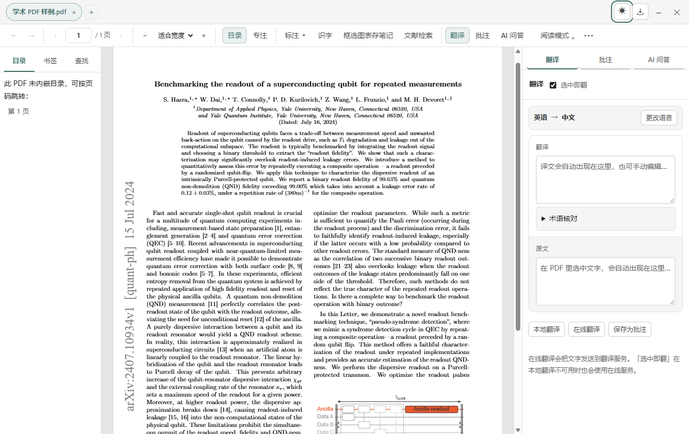
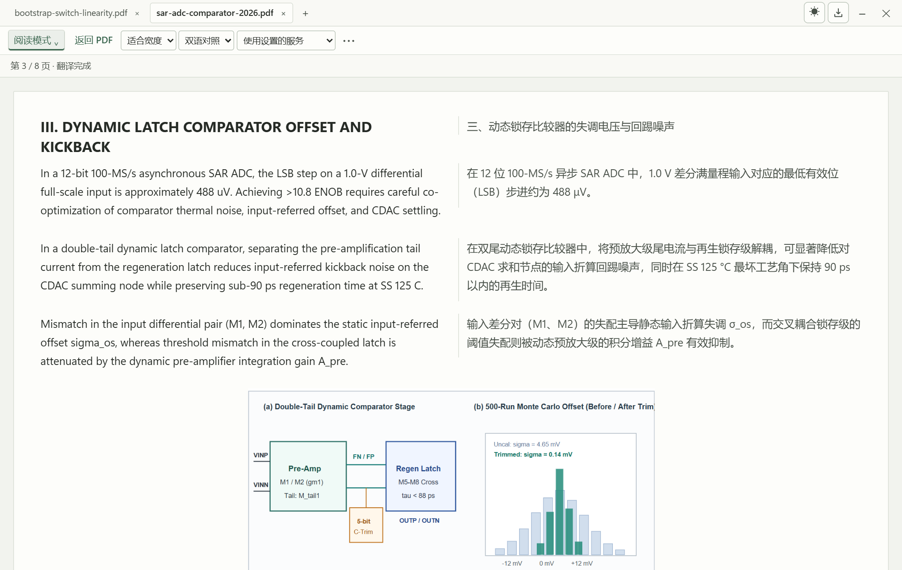
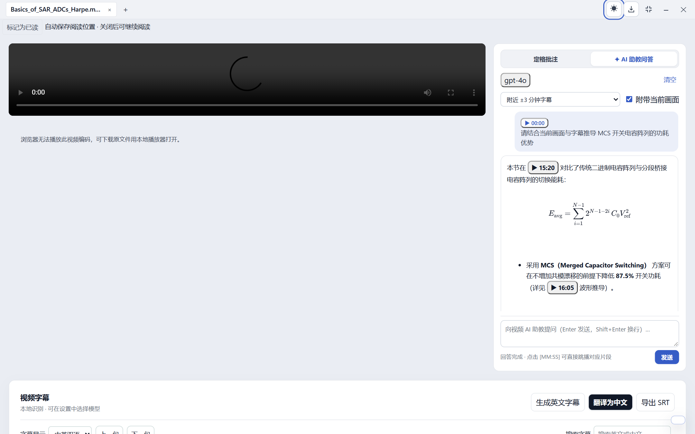
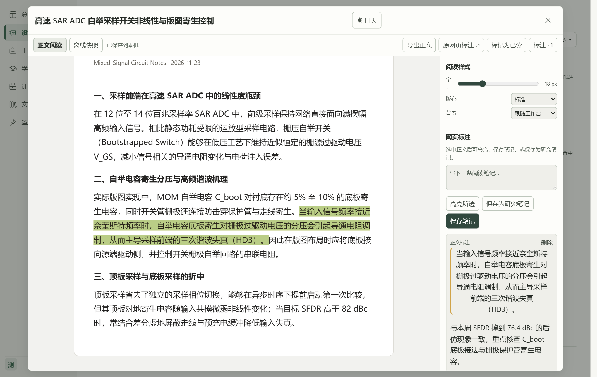

# DoNote · 本地优先的知识精读与课题研究工作台

[-2e5984?style=flat-square)](https://github.com/yamccle/DoNote/releases/tag/r143)
[](https://github.com/yamccle/DoNote/releases/latest)
[](#系统架构与仓库导览)
[](#5-云盘文件夹多端协同)

**DoNote** 是一款面向跨学科文献精读、课程学习与工程/科研课题攻关的 **Windows 桌面端知识工作台**。项目最初诞生于模拟与混合信号集成电路（IC）硬核论文推导与设计问题排查场景，现已全面演进为覆盖理工科研、方法学综述与专业研发的通用研究底座。

它将 **文献 PDF、课程讲义 PPT/PPTX、学术研讨视频与公开网页** 统一纳入本机自主可控的资料库，围绕 **「拖拽分拣入库 → 多模态精读与三级加速双语对照 → 公式级 AI 推导问答 → 关联课题问题与实验日志 → 原文选区双向回跳 → 云盘文件夹跨设备接力」** 这一完整研究闭环组织日常知识工作。

- **本地优先**。记录、原始附件和阅读进度默认保存在本机。支持离线 OCR、全文检索、本地语音识别和本地/云端加速翻译。程序安装、覆盖升级与默认卸载均完整保留用户资料与本地模型。
- **云盘文件夹多端协同**。两台电脑选择同一个云盘同步文件夹，就能对齐资料目录。附件在打开时读取并核对 SHA-256。
- **当前正式版**为 **[r143 · 26.1143.0089](https://github.com/yamccle/DoNote/releases/tag/r143)**。该版本新增 **「用户级安装向导 `.exe` + 便携绿色 `.zip` 双轨分发」** 与 **「文献大模型翻译三级加速（轻模型级联与多段打包批译、可选 Vulkan GPU 加速、OpenAI 兼容并发 API）」**。构建源码见 [r143 标签](https://github.com/yamccle/DoNote/tree/r143)。

---

## 目录

1. [核心能力全景矩阵](#核心能力全景矩阵)
2. [核心工作流与界面预览](#核心工作流与界面预览)
3. [下载、安装与在线自动升级](#下载安装与在线自动升级)
4. [多级容灾备份与跨设备协同配置](#多级容灾备份与跨设备协同配置)
5. [离线语音识别与本地大模型翻译配置](#离线语音识别与本地大模型翻译配置)
6. [系统架构与仓库导览](#系统架构与仓库导览)
7. [开源致谢与许可证声明](#开源致谢与许可证声明)

---

## 核心能力全景矩阵

| 能力域 | 关键特性摘要 |
| --- | --- |
| **总览与组织架构** | 低饱和莫兰迪四色继续阅读进度环（PDF / 视频 / PPT / 网页）、行动导向动态计数（仅统计**进行中计划 / 剩余未解决问题 / 近 7 天新增文献**）、每日打开即留痕活跃图、全栏目常驻 `快捷指令 Ctrl+K` 聚光灯检索、问题与计划多列拖拽看板。 |
| **批量入库与治理** | 篮板式全局拖拽投递浮层与「投递归档分拣台」（一键清洗论文文件名冗余前后缀、即时建多级目录树、套用标签）、严格 `60px` 等高目录卡片、文献库默认按「最近打开 ↓」排序、研究方向自动拦截日期/课件文件名污染并支持一键无损收纳杂项。 |
| **PDF 深度精读** | 多标签并行阅读、`1 GB+` 超长文档按区间流式读取、选中即翻与专业双语术语胶囊、MinerU 智能单栏重排与段落双语对照、PDFMathTranslate 整页公式保护对照（支持轻模型级联路由、GGUF 多段打包批译、可选 Vulkan GPU 加速与 OpenAI 兼容并发 API）、扫描页框选离线 OCR 直入全文检索、六色紧凑批注与图表框选摘录、**「被引用 N」角标与双向选区回跳**、流式 KaTeX 公式 AI 问答。 |
| **视频多模态学习** | 本地 `faster-whisper` 分段语音识别、「识别时同步离线翻译」边看边出双语字幕、画面原生双语字幕轨与可编辑时间轴、框选画面定格批注，以及 **「✦ AI 助教问答」多模态面板**（自动截取当前视频帧 + 附近/全片字幕上下文、KaTeX 公式推导、点击 `[MM:SS]` 时间码一键跳播与沉淀笔记）。 |
| **PPT 讲义与网页收藏** | PPT / PPTX 胶片导航、网格总览、沉浸放映、原片讲义自动提取、逐页批注保存及一键导出双栏图文复习讲义（`.html` / `.md`）；单进程 8 路并发防 SSRF 极速收藏公开网页（支持极速纯正文模式）与原文摘录高亮回跳。 |
| **多端协同** | 通过 Google Drive 桌面版、坚果云或 Nextcloud 同步文件夹对齐目录。按内容指纹保存附件，打开时读取和校验。 |
| **外部 AI 与任务中心** | 内置 AI Bridge 与 **MCP（Model Context Protocol）** 授权网关（8 项细粒度读写权限，撤销凭证即刻彻底清除）；顶栏与全屏阅读器浮标统一汇总更新下载、语音识别、离线翻译、备份恢复、网页抓取与同步进度。 |
| **系统体验与典藏** | 四栏自适应偏好设置中心（`外观与阅读 · AI 与翻译 · 多端协同 · 资料与系统`）、启动静默检查和一次确认的多步在线更新、十张里程碑卡牌「成就殿宇」（第 01 卡致敬模拟 IC 初心，支持在设置中自由隐藏）。 |

---

## 核心工作流与界面预览

### 1. 莫兰迪 Bento 总览、行动导向指标与 `Ctrl+K` 快捷指令

打开软件即进入克制舒展的学术纸感「总览」首屏：
- **继续阅读（低饱和类型色相区分）**：按具体附件精确恢复最近一次未读完的 PDF 页码、视频时间码、PPT 幻灯片页或离线网页滚动位置，并以石板靛蓝（PDF）、松石鼠尾草（视频）、暖陶橙（PPT）与雾紫（网页）低饱和色彩柔和区分资料形态。
- **行动导向指标与每日使用足迹**：摒弃焦虑的历史总计数——左侧边栏与总览指标卡中，**计划仅显示正在进行的项、问题仅显示剩余未解决的项、文献仅显示最近 7 天新增的资料**；右侧「记录的足迹」只要当日打开或使用软件即自动点亮足迹，真实记录每一天的科研与学习陪伴。
- **顶栏常驻 `快捷指令 Ctrl+K` 与后台任务入口**：一键唤出全库聚光灯搜索（覆盖记录、PDF 正文/OCR、PPT 讲义与视频字幕）或实时查看后台识别、翻译与下载进度。


### 2. PDF 深度精读、智能重排对照与双向选区回跳

内置 PDF 阅读器专为长篇学术论文与工程手册打造，支持多标签与 PPT 并排切换及超 `1 GB` 文档按需区间读取：
- **无嵌套顺向翻译与专业术语胶囊**：选中英文段落或对扫描页运行离线「框选识字」后，右侧栏按「原文 → 专业术语胶囊 → 译文」顺向呈现，支持本地离线模型或在线引擎一键互换语向；内置基于 MinerU 的「智能排版 / 排版翻译」与 PDFMathTranslate「整页对照翻译」，将双栏论文重排为单栏结构化双语对照视图。
- **双向证据链与原出处选区回跳**：可将正文摘录、框选的电路/实验图表或 AI 推导解析保存为独立笔记，或直接 **「追加到已有记录」**（如设计问题、实验调研或日志）。记录详情底部「引用资料」点击即可跳回原 PDF 对应页并闪烁高亮原选区；阅读 PDF 时页面右上角同步显示 **「被引用 N」** 角标，侧栏「引用」页签支持反向穿梭核查。



| 课题问题详情：截取图表与「引用资料」精准回跳 | PDF 智能排版：双栏论文结构化重排与段落双语对照 |
| --- | --- |
|  |  |

### 3. 视频双语同步字幕与多模态 AI 助教问答

将课程讲座或学术报告视频导入资料库后，可在学习工作台中实现音视频、双语字幕与视觉课件的深度联动：
- **边识别边翻译的双语字幕流**：调用本地 `faster-whisper` 模型分段提取英文字幕，默认开启「识别时同步翻译」，每识别出一批字幕即并行调用内置离线翻译模型生成中文；即使关闭视频窗口，后台任务仍持续运行并在右上角「任务中心」实时汇报进度。生成中或完成后，点任务或「打开视频」即可返回原视频。
- **「定格批注 | ✦ AI 助教问答」双页签面板**：遇到复杂课件推导时暂停视频，切换至 **「✦ AI 助教问答」**，系统自动截取**当前视频画面帧**并附带**附近 ±3 分钟（或全片）双语字幕时间轴**发送给多模态大模型；回答支持完整 Markdown 与 KaTeX 数学公式渲染，点击回答中的 `[MM:SS]` 时间码胶囊即可直接跳播对应讲解片段，并支持一键存为定格批注或研究笔记。




### 4. 篮板式拖拽分拣、多级目录治理与网页离线收藏

- **篮板式全局拖拽投递与分拣工作台**：将外部 PDF、PPTX、DOCX、Markdown 或音视频文件直接拖入窗口任意位置，即刻唤起柔和的篮板式投递提示与「投递归档分拣台」——支持入库前一键清洗论文文件名中的年份括号/版本号前后缀、选择目标栏目或合并为单条多附件记录、即时创建多级子文件夹（如 `2026 春季专题/因果推断`）并批量赋予研究标签。
- **严格等高目录树与研究方向降噪治理**：资料库文件夹卡片锁定 `60px` 统一高度，默认按 **「最近打开 ↓」** 排序；「文件夹管理」默认折叠子层级并支持深层路径搜索。「管理研究方向」自动拦截组会日期（如 `20260811`）与课件文件名污染宏观方向列表，并提供 **「一键收纳杂项（保留记录标签）」** 无损清理工具。
- **单进程极速网页收藏**：支持公开网页正文净化与配图并发缓存（或勾选「极速纯正文模式」秒级入库），离线批注后可从研究笔记一键回跳原句位置。

| 篮板式拖拽分拣台：一键清洗标题、新建子目录与批量打标 | 多级目录与网页离线摘录回跳 |
| --- | --- |
|  |  |

### 5. 云盘文件夹多端协同

两台电脑使用同一个云盘客户端同步目录。打开「设置 → 多端协同 → 云盘文件夹」，选择该目录。DoNote 在所选文件夹下建立 `DoNote` 子目录，云盘客户端负责上传和下载。

- **先同步目录**。另一台电脑先看到资料记录。记录更新和删除标记会随目录对齐。
- **按需打开附件**。阅读时才读取所选附件，并核对 SHA-256。云盘客户端还在传输时，阅读器会提示等待该文件。资料库封面使用本机已有的附件。
- **访问由云盘管理**。同步文件保存在所选云盘目录中，按云盘客户端的权限共享。


### 6. 成就殿宇十卡体系与外部 AI 助手（MCP）连接器

- **成就殿宇（致敬初心与长期主义）**：内置 10 张精绘 3D 翻面里程碑卡牌——第 `01` 张永久保留「信号路径 · 初心」致敬软件起源，其余 9 张融合文献入库、跨格式批注沉淀与 `7 天 / 30 天` 持续活跃目标；若偏好极简界面，可在「偏好设置 → 外观与阅读」中随时一键隐藏成就殿宇。
- **精简版 AI 助手连接器（MCP）**：支持一键启动本机桥接服务，按「只读 / 可写 / 完整权限」或 8 项细粒度范围生成独立助手令牌，供 Claude Desktop、Cursor、Grok 等外部 AI 工具通过标准 MCP 协议安全读写工作台快照与视频字幕；撤销任一助手凭证即刻从状态库彻底清除，绝不堆积失效条目。


---

## 下载、安装与在线自动升级

### 正式版下载

[GitHub 最新发行版](https://github.com/yamccle/DoNote/releases/latest)包含 **用户级安装向导**、**便携绿色压缩包**、**增量补丁** 与 **SHA-256 校验清单**。离线模型分卷可从[模型包发行页](https://github.com/yamccle/DoNote/releases/tag/models-2026-11-23)单独下载。

| 文件 | 用途 | 大小 | SHA-256 |
| --- | --- | ---: | --- |
| [Windows x64 安装向导](https://github.com/yamccle/DoNote/releases/download/r143/DoNote-Setup-x64-r143.exe) | **推荐首次安装或无损覆盖升级**（免管理员权限，自动建快捷方式与注册卸载项） | 1,070,752,765 字节 | `04363fa3f5096f382f5e80e2d123df420e0950aad83b84ee120fa74abfd9bcb2` |
| [Windows x64 便携完整包](https://github.com/yamccle/DoNote/releases/download/r143/DoNote-Windows-x64-r143.zip) | 绿色免安装解压即用（适合 U 盘或自定义路径） | 1,070,584,773 字节 | `6c0b7ce6e131677accc7859e8d11133feee2f17bd7a85b8a2570f9986f50a79e` |
| [r142 → r143 增量包](https://github.com/yamccle/DoNote/releases/download/r143/DoNote-Update-26.1142.0088-to-r143.zip) | 本机已安装 `r142`（亦可软件内自动检查更新） | 572,846 字节 | `457380411c9866f9445eba769a8e5d97d86c2dff1e396a13e3a646c9ab3a0cbc` |
| [r143 发布记录](https://github.com/yamccle/DoNote/releases/download/r143/DoNote-r143-release.json) | 源码提交、依赖锁与全量门禁结果 | 1,212 字节 | `a06f3a38387a75b0ebe89d0569582821f7b803bb0e89533d47df6eb03768b53d` |
| [SHA256SUMS.txt](https://github.com/yamccle/DoNote/releases/download/r143/SHA256SUMS.txt) | 发行产物公开 SHA-256 校验文本 | 382 字节 | 核对上述 4 项下载指纹 |

### 双轨安装、校验提示与无损升级

1. **方式 A · 用户级安装向导（推荐）**：在 Windows 10 或 11 x64 上双击 `DoNote-Setup-x64-r143.exe`，默认安装到 `%LocalAppData%\Programs\DoNote`（无需管理员权限），支持覆盖升级保留 `Data/` 与 `models/`，默认安全卸载亦完整保留个人资料库与模型。
   - **SmartScreen 提示与 SHA-256 核对**：现阶段安装包暂未接入商业代码签名，从网络下载后首次运行如遇 Windows SmartScreen 拦截，点击 **「更多信息」→「仍要运行」** 即可；安装前可在 PowerShell 运行 `Get-FileHash .\DoNote-Setup-x64-r143.exe -Algorithm SHA256` 对照上表与 `SHA256SUMS.txt` 确认文件未被篡改。
2. **方式 B · 便携绿色压缩包**：解压 `DoNote-Windows-x64-r143.zip` 至任意读写目录，双击 `DoNote.exe` 即可运行（依赖系统内置 [Microsoft Edge WebView2 Runtime](https://developer.microsoft.com/en-us/microsoft-edge/webview2/)）。
3. **软件内一键在线升级**：打开「设置 → 资料与系统 → 检查在线更新」（或点「选择本地 ZIP…」选增量包），DoNote 会自动计算最短更新路径、校验全部文件哈希、暂存编辑状态并按序无损升级（完整保留 `Data/` 与 `models/`）。
4. **失败后继续**：某一步安装失败时，更新器会回退该步。再次检查更新时会从最后成功的版本选包。

---

## 多级容灾备份与跨设备协同配置

### 1. 本机流式大目录备份与云端版本化快照

打开「偏好设置 → 资料与系统 → **备份与恢复**」（或顶栏备份按钮），三维存储健康栏会实时展示当前记录规模、本机磁盘占用与上次外部备份状态：
- **流式备份到文件夹（推荐 · 不限容量）**：面向数 GB 至数十 GB 大型文献与视频资料库，导出前自动检查目标盘剩余空间，分块流式写入移动硬盘或 NAS 目录，逐个附件生成 SHA-256 校验清单并附带单文件应急只读版 `离线阅读.html`。
- **云端版本化快照（Google Drive / WebDAV）**：支持绑定桌面版 [Google 云端硬盘同步目录](https://support.google.com/drive/answer/13401938?hl=zh-Hans) 或 HTTPS WebDAV 服务器（亦可搭配 [rclone serve webdav](https://rclone.org/commands/rclone_serve_webdav/)），生成带完成标记与 SHA-256 校验值的版本化归档，支持自动保留最近 `3 / 5 / 10 / 20` 份快照并安全清理超限旧版本。
- **轻量单文件导出与增量无损恢复**：总附件 `500 MB` 内支持一键导出 ZIP / JSON，或仅导出纯文本 Markdown 大纲；恢复导入时自动按记录编号与内容指纹跳过重复项并重映射文献引用关系，绝不覆盖既有笔记。

### 2. 在另一台电脑继续阅读

1. 在两台电脑上安装同一云盘客户端，例如 Google Drive 桌面版、坚果云或 Nextcloud，并同步同一个文件夹。
2. 在 DoNote 的「设置 → 多端协同」分别选择该文件夹，点击「立即对齐」。
3. 在第一台电脑加一份资料。目录同步后，在第二台打开该附件。云盘文件夹中的资料可随使用需要逐份读取。

云端备份用于保留可恢复的版本。多端协同用于对齐两台电脑的资料目录。

---

## 离线语音识别与本地大模型翻译配置

**不下载额外模型亦可完整使用 DoNote 核心功能**：日常记录、PDF/PPT 精读批注、网页收藏、离线 OCR、全文检索、云端 AI 问答，以及**随程序包内置的快速离线英译中模型**（`Helsinki-NLP opus-mt-en-zh` INT8，用于视频同步字幕翻译与 PDF 快速离线翻译）均开箱即用。仅当需要**本地视频语音转写**或**本地 Qwen3 大模型深度翻译**时，可按需选配以下权重：

> **GitHub 离线模型整合包分卷（[`models-2026-11-23` Release](https://github.com/yamccle/DoNote/releases/tag/models-2026-11-23)）**：  
> 内含全部 4 档 Whisper 识别模型与 3 档 Qwen3 GGUF 翻译模型，提供 `Models.z01`～`Models.z12`（每卷 `734,003,200` 字节）+ `Models.zip`（末卷 `445,573,902` 字节）+ `SHA256SUMS.txt` 共 14 个文件。下载至同一目录后可在 PowerShell 中一键拼接还原：
> ```powershell
> $all = @(Get-ChildItem Models.z* | Sort-Object Name) + @(Get-Item Models.zip)
> $out = [IO.File]::Create("Models.zip.full")
> foreach ($f in $all) { $s = $f.OpenRead(); $s.CopyTo($out); $s.Dispose() }
> $out.Dispose()
> # 拼接后 Models.zip.full 大小应为 9,253,612,302 字节，SHA-256: e1b8957884885cc41e67a1fc722bf045b18259dff3a5273e4eebbc6cc56371f4
> # 改名为 Models.zip 解压得到内层 DoNote-Models-x64-2026-11-23.zip (SHA-256: ca4eb5cee6006923ef27a76074f3676116cfa7c40978b180258b90509f847cb6)
> # 解压内层包并先完全退出 DoNote，双击「安装模型.cmd」即可自动补装缺失模型。
> ```

### 1. 视频语音识别模型（`faster-whisper`，按需选装一档）

- **自动国内镜像下载（推荐）**：点击视频「生成英文字幕」时，若本地未预置对应档位，程序会自动经国内镜像 `hf-mirror.com` 下载并缓存，进度实时显示于右上角任务中心（可通过环境变量 `DONOTE_HF_ENDPOINT=official` 切换 Hugging Face 官方源）。
- **手动离线放入目录**：将对应档位的 `config.json`、`model.bin`、`tokenizer.json`（及 `base`/`small` 的 `vocabulary.txt`，或 `large-v3-turbo`/`large-v3` 的 `vocabulary.json` + `preprocessor_config.json`）放入 `DoNote.exe` 同级的 `models\asr\<目录名>\`：

| 软件内档位 | 本地存放路径 | 国内镜像文件页 | Hugging Face 官方页 | `model.bin` 字节数与 SHA-256 |
| --- | --- | --- | --- | --- |
| 轻量 · `base` | `models\asr\base` | [hf-mirror · base](https://hf-mirror.com/Systran/faster-whisper-base/tree/ebe41f70d5b6dfa9166e2c581c45c9c0cfc57b66) | [HF · base](https://huggingface.co/Systran/faster-whisper-base/tree/ebe41f70d5b6dfa9166e2c581c45c9c0cfc57b66) | 145,217,532 字节<br>`d01c3014881c9c6f3133c182f3d2887eb6ca1c789a7538c5c007196857a0a6a9` |
| 轻量 · `small`（默认） | `models\asr\small` | [hf-mirror · small](https://hf-mirror.com/Systran/faster-whisper-small/tree/536b0662742c02347bc0e980a01041f333bce120) | [HF · small](https://huggingface.co/Systran/faster-whisper-small/tree/536b0662742c02347bc0e980a01041f333bce120) | 483,546,902 字节<br>`3e305921506d8872816023e4c273e75d2419fb89b24da97b4fe7bce14170d671` |
| 均衡 · `large-v3-turbo` | `models\asr\large-v3-turbo` | [hf-mirror · turbo](https://hf-mirror.com/dropbox-dash/faster-whisper-large-v3-turbo/tree/0a363e9161cbc7ed1431c9597a8ceaf0c4f78fcf) | [HF · turbo](https://huggingface.co/dropbox-dash/faster-whisper-large-v3-turbo/tree/0a363e9161cbc7ed1431c9597a8ceaf0c4f78fcf) | 1,617,884,929 字节<br>`e76620f83d5f5b69efd3d87e3dc180c1bd21df9fbebacfd4335e5e1efcc018da` |
| 高准确 · `large-v3` | `models\asr\large-v3` | [hf-mirror · large-v3](https://hf-mirror.com/Systran/faster-whisper-large-v3/tree/edaa852ec7e145841d8ffdb056a99866b5f0a478) | [HF · large-v3](https://huggingface.co/Systran/faster-whisper-large-v3/tree/edaa852ec7e145841d8ffdb056a99866b5f0a478) | 3,087,284,237 字节<br>`69f74147e3334731bc3a76048724833325d2ec74642fb52620eda87352e3d4f1` |

### 2. 文献翻译三级加速：离线 GGUF、可选 Vulkan GPU 与云端并发 API

- **自动级联与流式多段批译（开箱即用）**：使用本地 `Qwen3` GGUF 翻译论文时，极短标题标签自动分流至内置 `opus-mt-en-zh` 瞬时直译，正文与公式段采用 `@@id@@` 零开销流式打包批译，退出对照后自动在后台完成 `±5` 页预缓存。
- **可选 Vulkan GPU 加速**：可在 DoNote 安装目录执行 `pwsh -File .\tools\enable-vulkan-gpu.ps1 -InstallDir <你的安装目录>` 安装独立的 `vulkan-dependencies` 加速层（支持 AMD / NVIDIA / Intel 核显与独显；传入 `-Disable` 可一键回退 CPU）。
- **云端大模型并发 API（1–3 秒整页）**：在「设置 → AI 与翻译 → 翻译服务」选择「云端大模型（OpenAI 兼容 · 并发极速）」，配置 DeepSeek、通义千问、OpenAI 或本地 Ollama 接口与并发数（1–16），支持一键连接测速、DPAPI 密钥加密持久化及划词/整页对照/智能排版跨视图即时热切换。

安装包已内置 `llama.cpp` 推理后端，下载任一 GGUF 权重按「保存目标文件名」放入 `models\translation\`（注意从 `bartowski` 下载 4B / 1.7B 时去掉文件名前缀 `Qwen_`），在「偏好设置 → AI 与翻译」将翻译源切换为「本地大模型」即可离线使用：

| 档位与定位 | 保存目标路径与文件名 | 国内镜像直链 | Hugging Face 直链 |
| --- | --- | --- | --- |
| **高质量（4B）** · 长段落专业消歧 | `models\translation\Qwen3-4B-Instruct-2507-Q4_K_M.gguf`（约 2.33 GiB） | [hf-mirror 下载](https://hf-mirror.com/bartowski/Qwen_Qwen3-4B-Instruct-2507-GGUF/resolve/main/Qwen_Qwen3-4B-Instruct-2507-Q4_K_M.gguf) | [HF 下载](https://huggingface.co/bartowski/Qwen_Qwen3-4B-Instruct-2507-GGUF/resolve/main/Qwen_Qwen3-4B-Instruct-2507-Q4_K_M.gguf) |
| **轻量（1.7B）** · 日常精读均衡之选 | `models\translation\Qwen3-1.7B-Q4_K_M.gguf`（约 1.19 GiB） | [hf-mirror 下载](https://hf-mirror.com/bartowski/Qwen_Qwen3-1.7B-GGUF/resolve/main/Qwen_Qwen3-1.7B-Q4_K_M.gguf) | [HF 下载](https://huggingface.co/bartowski/Qwen_Qwen3-1.7B-GGUF/resolve/main/Qwen_Qwen3-1.7B-Q4_K_M.gguf) |
| **极速（0.6B）** · 低占用快速浏览 | `models\translation\Qwen3-0.6B-Q8_0.gguf`（约 610 MiB） | [hf-mirror 下载](https://hf-mirror.com/Qwen/Qwen3-0.6B-GGUF/resolve/main/Qwen3-0.6B-Q8_0.gguf) | [HF 下载](https://huggingface.co/Qwen/Qwen3-0.6B-GGUF/resolve/main/Qwen3-0.6B-Q8_0.gguf) |

详见随包说明：[视频模型下载说明](work/desktop/视频模型下载说明.md) · [本地离线翻译模型说明](work/desktop/本地离线翻译模型说明.md) · [模型目录说明](work/desktop/模型目录说明.md) · [MinerU 智能排版说明](work/desktop/MinerU智能排版说明.md)。

---

## 系统架构与仓库导览

```
DoNote/
├── work/desktop/              # Windows 桌面宿主 (C# WinForms + WebView2)、四栏设置中心、静默/在线更新器、文件夹协同、云备份与本地进程桥
├── work/analog-notes/public/  # 工作台前端核心：莫兰迪总览、拖拽分拣台、研究方向治理、PDF/PPT/网页/视频多模态阅读器与后台任务中心
├── work/analog-notes/scripts/ # 桌面分文件工作台打包与单文件便携离线 HTML 构建脚本
├── work/ai-bridge/            # 本机与自建节点服务：MCP 外部助手授权网关与同步服务接口
├── work/video-runtime-build/  # 纳入版本控制的定制双语排版翻译源码子模块（Python 运行时由锁定归档提供）
├── tools/                     # 确定性发布流水线 tools/release.ps1 与全链路隔离回归测试套件 tools/tests/
└── docs/                      # 发布溯源与依赖锁 (docs/releases/)、工程交接指南 (docs/HANDOFF.md) 与界面截图
```

### 从源码构建与发布校验

重建该版本请先检出 `r143` 标签。构建环境需准备 Windows x64、PowerShell 7、.NET Framework 4.x `csc.exe`、Node.js（≥ 22）、Git、Microsoft Edge Stable 与 Playwright，并放置 [docs/releases/runtime-lock.json](docs/releases/runtime-lock.json) 锁定的 `r122` 运行依赖归档：

```powershell
# 验证工作台、更新链、安装向导及文献翻译加速
node tools/tests/test-workspace.mjs <候选构建目录>/workspace
pwsh -File tools/tests/test-update-chain.ps1
pwsh -File tools/tests/test-setup-installer.ps1

# 已有锁定的运行依赖和本地 r142 完整包时，可重建 r143（同步产出安装向导 .exe + 便携 .zip + 增量包 + SHA256SUMS.txt）
pwsh -File tools/release.ps1 -Revision r143 -Version 26.1143.0089 `
  -RuntimeArchive .\outputs\DoNote-Windows-x64-2026-11-21-r122-交互优化.zip `
  -PreviousReleaseZip .\outputs\r142\DoNote-Windows-x64-r142.zip `
  -OutputDirectory .\outputs
```

工程架构规范与维护细则请参阅 [AGENTS.md](AGENTS.md)、[docs/HANDOFF.md](docs/HANDOFF.md) 与 [docs/releases/README.md](docs/releases/README.md)。

---

## 开源致谢与许可证声明

DoNote 基于以下优秀的开源软件与公开模型权重构建（各组件完整许可证文本随发布包附于 `docs/licenses/`、`ai-bridge/Node-LICENSE.txt`、`video-runtime/LICENSE.txt` 及 `workspace/` 对应目录）：

### 1. 桌面宿主与内嵌运行时
- **Microsoft Edge WebView2 SDK**（[developer.microsoft.com](https://developer.microsoft.com/en-us/microsoft-edge/webview2/)）：Microsoft Edge WebView2 SDK License（见 `docs/licenses/LICENSE.txt`）
- **Node.js `v24.22.1`**（[github.com/nodejs/node](https://github.com/nodejs/node)）：MIT License 及随附组件许可（见 `ai-bridge/Node-LICENSE.txt`）
- **Python `3.12.10`**（[github.com/python/cpython](https://github.com/python/cpython)）：PSF-2.0（见 `video-runtime/LICENSE.txt`）

### 2. 工作台与多格式阅读器组件
- **PDF.js `5.6.205`**（[github.com/mozilla/pdf.js](https://github.com/mozilla/pdf.js)）：Apache-2.0（含随附解码器与标准字体对应 BSD / GPLv2 with Font Exception 条款）
- **pdf-lib**（[github.com/Hopding/pdf-lib](https://github.com/Hopding/pdf-lib)）· **KaTeX**（[github.com/KaTeX/KaTeX](https://github.com/KaTeX/KaTeX)）· **Marked**（[github.com/markedjs/marked](https://github.com/markedjs/marked)）· **MiniSearch**（[github.com/lucaong/minisearch](https://github.com/lucaong/minisearch)）· **`@web-ppt/core` & `fflate`**（[github.com/unStone/web-ppt](https://github.com/unStone/web-ppt)）· **js-sha256**（[github.com/emn178/js-sha256](https://github.com/emn178/js-sha256)）：MIT License
- **Citation.js（含 `moo`）**（[github.com/citation-js/citation-js](https://github.com/citation-js/citation-js)）：MIT License（`moo` 为 BSD-3-Clause）
- **JSZip**（[github.com/Stuk/jszip](https://github.com/Stuk/jszip)）：MIT 或 GPL-3.0 双重许可（本项目按 MIT 使用）
- **Tesseract.js**（[github.com/naptha/tesseract.js](https://github.com/naptha/tesseract.js)）· **Mozilla Readability**（[github.com/mozilla/readability](https://github.com/mozilla/readability)）：Apache-2.0

### 3. 版面解析、离线语音、翻译推理与字体
- **MinerU `4.2.1`**（[github.com/opendatalab/MinerU](https://github.com/opendatalab/MinerU)）：MinerU Open Source License（见 `docs/licenses/MINERU-LICENSE.md`）
- **PDFMathTranslate (`pdf2zh`)、BabelDOC、DocLayout-YOLO & PyMuPDF**（修改版源码位于 `work/video-runtime-build/pdfmathtranslate-src/`）：PDFMathTranslate、BabelDOC、PyMuPDF 为 AGPL-3.0；DocLayout-YOLO 为 Apache-2.0（见 `docs/licenses/PDFMATHTRANSLATE-AGPL-3.0.txt`）
- **bilingual_book_maker（及依赖 EbookLib）**（修改版源码位于 `work/video-runtime-build/bilingual-book-maker-src/`）：`bilingual_book_maker` 为 MIT License；`EbookLib` 为 AGPL-3.0-or-later
- **faster-whisper、CTranslate2、PyAV & ONNX Runtime**：`faster-whisper`、`CTranslate2`、`ONNX Runtime` 为 MIT License；`PyAV` 为 BSD-3-Clause（随附 FFmpeg 动态库适用 LGPL / GPL 对应条款）
- **Helsinki-NLP `opus-mt-en-zh` & SentencePiece**：上游 OPUS-MT 模型为 CC-BY-4.0（随包 CTranslate2 转换版声明 Apache-2.0）；`SentencePiece` 为 Apache-2.0
- **llama-cpp-python / llama.cpp**：MIT License；可选下载权重 **Whisper**（MIT License）与 **Qwen3**（Apache-2.0，见 `docs/licenses/QWEN3-LICENSE.txt`）
- **Noto Sans SC / Source Han Serif CN（思源黑体 / 思源宋体）**：SIL Open Font License 1.1（见 `docs/licenses/NotoSansSC-OFL.txt`）

### 4. DoNote 自身权利与合规说明
当前仓库尚未对 DoNote 原创代码与文档单独授予开源许可证，在维护者补充仓库级 `LICENSE` 前默认保留所有权利；仓库内随附的第三方修改源码子目录及发布包集成的各开源组件均各自继续适用其上游开源许可证条款。如认为项目中的内容侵犯了您的权利，请通过 [GitHub Issues](https://github.com/yamccle/DoNote/issues) 联系维护者。核实后会更正或移除相关内容。
