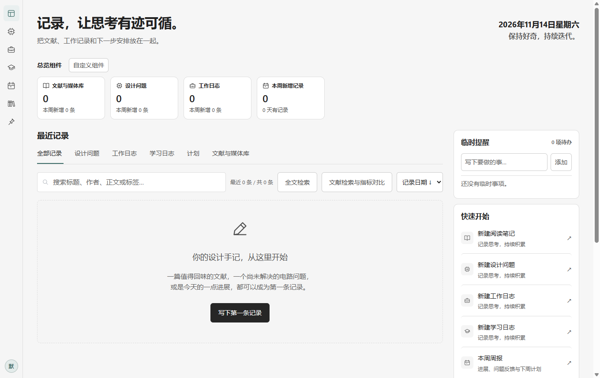
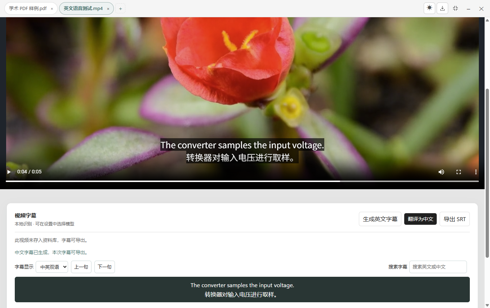

# DoNote · 本地优先的工程研究工作台

DoNote 是一个 Windows 桌面端的研究工作台：把网页、PDF、图片、视频收进同一个资料库，阅读、标注、翻译、摘录、写成记录，围绕「阅读 → 摘录 → 形成记录 → 找回出处」这一条线工作。

- 桌面壳：C# WinForms + WebView2；工作台：原生 JS，无框架
- 默认全程离线：笔记、附件、OCR、语音识别、本地翻译模型都在本机运行；只有你主动选择「AI / API」时，文本才会发到你配置的服务
- 数据保存在本机（WebView2 IndexedDB + `Data/` 目录），整个安装目录拷走即可迁移

## 截图

| 工作台 | 阅读器 |
| --- | --- |
|  |  |
| **智能排版翻译** | **视频双语字幕** |
|  |  |

## 下载

最新版本见 **[Releases](https://github.com/yamccle/DoNote/releases/latest)**：

| 文件 | 说明 |
| --- | --- |
| `DoNote-Windows-x64-rNNN.zip` | 完整包，首次安装使用 |
| `DoNote-Update-<旧版本>-to-rNNN.zip` | 增量包，只包含变化文件 |
| `DoNote-rNNN-release.json` | 发布记录：源码提交、SHA-256、检查项 |

运行要求：Windows 10 / 11 x64。解压后双击 `DoNote.exe`。

> 模型包（语音识别 + 本地大模型翻译，约 9.25 GB）超出 GitHub Release 单文件上限，不放在本仓库；获取方式见下方「模型」。

## 安装与升级

- **首次安装**：解压完整包到任意目录，双击 `DoNote.exe`；
- **升级**：把增量包或完整包交给「设置 → 检查更新包…」，程序会备份并替换程序文件，**不会删除**资料库、`Data/` 和 `models/`；安装失败自动回退旧版本；
- **迁移**：整个安装目录（含 `Data/`）拷到新电脑即可。

## 模型

| 用途 | 获取方式 |
| --- | --- |
| 语音识别（faster-whisper：base / small / large-v3-turbo / large-v3） | 首次使用时自动下载，默认走 `hf-mirror.com`；可用 `DONOTE_HF_ENDPOINT` 换源（`official` 表示官方地址），也可手动放入 `models\asr\<模型名>` |
| 本地大模型翻译（Qwen3 4B / 1.7B / 0.6B，GGUF） | 按 [本地离线翻译模型说明](work/desktop/本地离线翻译模型说明.md) 的链接下载后放入 `models\translation`，或安装模型包 |
| 离线字幕英译中（内置小模型） | 随安装包自带 |

不装模型时笔记、PDF、AI 问答、备份等功能仍可使用，只是离线语音识别和本地大模型翻译不可用。

## 开发与构建

工具链：Windows x64、PowerShell 7、.NET Framework `csc`、Node.js、Git、Edge（发布回归用 Playwright）。

```powershell
# 构建桌面端
pwsh -File work/desktop/build.ps1 -RuntimeArchive <锁定的运行依赖包> -Output <输出目录> `
  -ReleaseVersion 26.1128.0074 -SourceCommit <提交>

# 正式发布：干净工作树，自动跑回归，生成完整包 + 增量包 + 发布记录
pwsh -File tools/release.ps1 -Revision r128 -Version 26.1128.0074 `
  -RuntimeArchive <锁定的运行依赖包> -PreviousReleaseZip <上一版完整包> -OutputDirectory outputs
```

- 发布流程与运行依赖锁定：[docs/releases/README.md](docs/releases/README.md)
- 回归测试：`tools/tests/test-workspace.mjs`（大 PDF、草稿、字幕）、`tools/tests/test-release-update.ps1`（升级与回退）
- 接手说明：[docs/HANDOFF.md](docs/HANDOFF.md)；仓库规则：[AGENTS.md](AGENTS.md) 及各目录 `AGENTS.md`

## 目录结构

| 路径 | 作用 |
| --- | --- |
| `work/desktop/` | Windows 宿主、更新器、模型安装器、构建脚本 |
| `work/analog-notes/public/` | 工作台 / 编辑器 / PDF / 视频界面 |
| `work/analog-notes/scripts/` | 离线单文件 HTML 构建入口 |
| `work/ai-bridge/` | 外部助手接口、MCP、本机授权 |
| `work/video-runtime-build/` | 视频识别 / 翻译运行依赖（构建期资源，不进发布包） |
| `tools/` | 发布脚本与回归测试 |
| `docs/` | 发布手册、接手说明、使用与模型文档 |

## 说明

- 工作台来源固定为 `yams-one.example`，升级时保持兼容；宿主与更新器共用 `YamsOne.Desktop` 互斥锁。
- 发布包不携带 `Data/` 和模型实体，更新时由更新器保护用户资料与模型。
- 第三方组件许可证随发布包的 `legal/` 目录提供。
