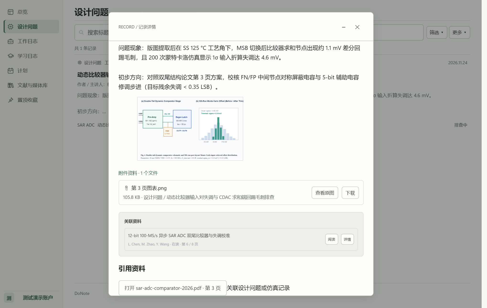
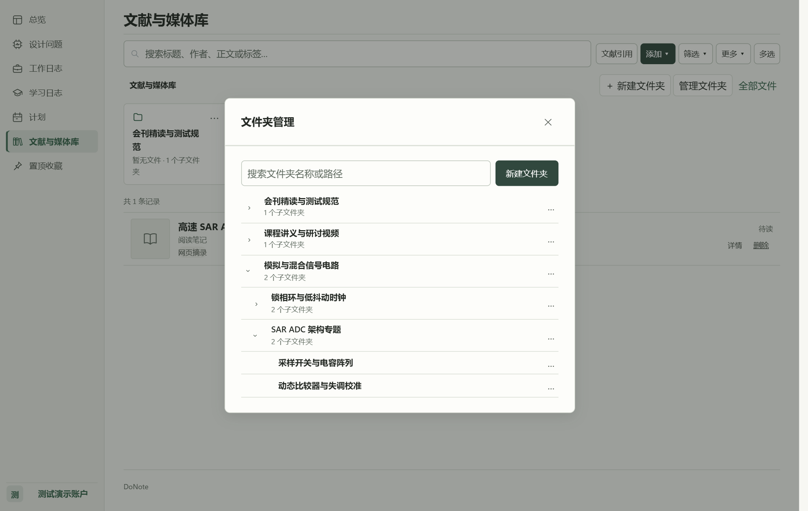

# DoNote · 本地优先的工程研究工作台

DoNote 是一款面向工程研发与学术精读的 **Windows 桌面端研究工作台**。它把文献 PDF、公开网页和课程/研讨视频收进同一个本地资料库，围绕 **「阅读 → 摘录 → 关联设计问题 / 仿真记录 / 学习日志 → 回查出处」** 这一条完整链路组织日常研究工作。

- **本地优先**：桌面端基于 C# WinForms 和 Microsoft Edge WebView2，工作台采用原生 JavaScript。记录、附件、阅读进度、批注、OCR、全文检索、语音识别和本地模型翻译都在本机处理。在线翻译、外部 AI 和云端备份按所选服务处理相应内容。
- **数据自主可控**：工作台数据保存在本机（WebView2 IndexedDB 与程序同级 `Data/` 目录，或 `data-location.txt` 指定的自定义资料目录），不改写原始 PDF 与媒体文件；常规程序升级自动保护用户资料与本地模型，整目录拷贝即可离线迁移。
- **当前正式程序基线**：`r132`（版本号 `26.1132.0078`，对应源码标签 `r132` / 提交 `eb4c918`）。界面截图来自 `r132`，使用独立测试账户和演示资料。

---

## 核心工作流程与界面预览

### 1. 总览续读与近期计划

打开软件即进入「总览」首屏：左侧 **「继续阅读」** 按具体附件恢复最近一次未读完的 PDF 页码、视频时间点或离线网页阅读进度（多附件记录会自动跳过已读完文件，直接定位正在阅读的附件）；右侧 **「接下来」** 汇总最先到期的未完成计划，下方衔接各栏目统计、临时提醒、快速开始与近 8 周记录足迹。


### 2. 将 PDF 选区追加到已有设计问题或仿真记录

内置 PDF 阅读器支持多标签并行打开文献、超过 1 GB 长文档按区间读取、选中即翻、六色高亮/下划线/矩形/手绘批注以及区域 OCR 识字。在阅读论文时选中关键段落或框选电路结构、仿真曲线图表后，除直接保存为独立研究笔记外，还可点击 **「追加到已有记录」**，将选区出处或截取的图表直接追加到已有的**设计问题**，或标题、标签、正文中包含「仿真」的**工作日志 / 学习日志**。


### 3. PDF 与网页摘录一键回跳原出处

所有摘录均携带精确来源锚点，随时可从设计思考回查原始证据：

- **PDF 引用回跳**：打开追加了 PDF 摘录的设计问题、仿真记录或研究笔记，详情页底部「引用资料」会列出原始文件名与页码（如 `打开 sar-adc-comparator-2026.pdf · 第 3 页`），点击即可重新打开原 PDF 对应页并用选区框高亮定位原段落或图表；移动记录所在文件夹或导入导出完整备份后，引用定位依然保留。
- **网页离线收藏与摘录回跳**：粘贴公开网页地址即可把净化正文与离线快照保存到本机。在「正文阅读」模式选中关键句子可高亮标注或点击「保存为研究笔记」；之后在笔记详情点击「打开原文摘录」，即可直接回到本地网页阅读器并滚动高亮定位到原句。

| 设计问题详情：截取图表与「引用资料」回跳入口 | 网页阅读器：离线正文标注与原文摘录高亮回跳 |
| --- | --- |
|  |  |

### 4. 多级文件夹管理与 PDF 智能排版对照

- **文件夹管理（默认折叠与深层搜索）**：文献与媒体库及各记录栏目共用统一的嵌套目录树，支持面包屑逐级浏览、导入本地文件夹自动建树、单条右键移动与多选批量移动（支持一键撤销，并自动拦截移入自身/子目录或跨栏目误操作）。「文件夹管理」窗口默认折叠子层级，点击 `›` 逐层展开，同时支持按名称或完整路径搜索深层目录；删除文件夹默认保留内容并移至上一级，仅在主动勾选时才将记录移入保留 30 天的回收站。
- **PDF 智能排版与双语对照**：除原版版式与 PDFMathTranslate「整页对照翻译」外，阅读器内置基于本地 MinerU 的「智能排版」与「排版翻译」，可将双栏英文论文重排为单栏结构化段落并按段左右对照显示中文译文，支持导出双语 HTML。

| 文件夹管理：默认折叠、逐层展开与深层搜索 | PDF 排版翻译：双栏论文结构化重排与按段双语对照 |
| --- | --- |
|  |  |

### 5. 视频双语字幕与识别时同步翻译

将课程讲义或技术研讨视频导入资料库后，可在内置播放器中调用本地 `faster-whisper` 语音模型分段生成英文字幕：

- **识别时同步翻译**：默认开启「识别时同步翻译」开关，每识别出一批英文字幕即并行调用安装包内置的离线英译中模型逐条生成中文，无需等待整段视频识别结束即可边看边出双语字幕；关闭预览窗口后后台任务仍继续执行并写回原所属本地账户。
- **时间轴校对、定格批注与导出**：画面叠加原生双语字幕轨，下方时间轴自动跟踪当前播放句，支持点击时间码跳播、展开任意字幕行修改中英文、对关键画面框选保存「定格批注」（点击批注跳回对应时间），以及一键导出双语 `.srt` 字幕文件。


### 其他常用能力

- **记录组织与周志模板**：从总览新建时提供记录类型选择器，在具体栏目内直接打开对应类型；支持按日工作日志、本周工作周志续写、组会周报模板、独立学习日志与起止日期计划管理。
- **多格式预览与文献引用**：记录支持单个最大 2 GB 的本地附件，内置 DOCX 正文/表格预览、PPT / PPTX 逐页预览及 Markdown 图文导入；文献库支持离线导入/导出 BibTeX 与 RIS 引用及跨文献全文检索。
- **草稿保护与多级备份**：编辑过程自动暂存最近草稿（含未提交附件字节）；提供 500 MB 内自包含 JSON / 离线资料夹 ZIP 备份、大文件原生流式文件夹备份以及 30 天回收站。
- **外部 AI 助手受控接入**：内置本机 AI Bridge 与 MCP（Model Context Protocol）服务，可按工作台发放细粒度权限令牌（读取快照、新增/更新记录、检索文献元数据等）。

## 云端备份

在新版桌面端打开「设置 → 资料与备份 → 备份与恢复 → 云端备份」。DoNote 将当前工作台保存为带日期和 SHA-256 校验值的独立快照。每台电脑继续使用自己的本地资料库。

- **Google Drive**：选择桌面版 Google 云端硬盘里的备份文件夹。DoNote 把备份写入该文件夹，Google 客户端负责上传。跨电脑恢复前，在 Google 客户端确认同步已完成。[Google 云端硬盘同步说明](https://support.google.com/drive/answer/13401938?hl=zh-Hans)
- **WebDAV**：填写服务器的 HTTPS 目录地址及所需凭证。通过 rclone 连接 Google Drive 时，可使用它提供的本机 WebDAV 地址。[rclone 的 Google Drive 接入](https://rclone.org/drive/) · [rclone WebDAV 文档](https://rclone.org/commands/rclone_serve_webdav/)

从列表下载并校验快照后，用「从备份文件夹恢复」导入解出的目录。导入会跳过重复记录。要查看一份历史备份的完整状态，可以先创建空白工作台，再导入该快照。[桌面版操作说明](work/desktop/开始使用.md#云端备份)

---

## 下载、安装与升级

> **提示**：正式程序发布页为 **[DoNote `r132` Release](https://github.com/yamccle/DoNote/releases/tag/r132)**；[GitHub Latest](https://github.com/yamccle/DoNote/releases/latest) 已确认指向 `r132`。模型整合包（分卷）位于独立的 [`models-2026-11-23` Release](https://github.com/yamccle/DoNote/releases/tag/models-2026-11-23)。所有历史版本可在 [Releases 列表](https://github.com/yamccle/DoNote/releases) 查看。

### 1. 程序包下载（正式版 `r132` · `26.1132.0078`）

程序发布页：**[DoNote `r132` Release](https://github.com/yamccle/DoNote/releases/tag/r132)**

| 文件 | 适用场景 | 大小 | SHA-256 |
| --- | --- | ---: | --- |
| [`DoNote-Windows-x64-r132.zip`](https://github.com/yamccle/DoNote/releases/download/r132/DoNote-Windows-x64-r132.zip) | **首次安装**，或从任意早于 `r131` 的旧版跨版本升级 | 1,070,401,707 字节（约 1.00 GiB） | `c49cb53bec388fdf6a8639b64a0c2c8b86799727cde2677ad43b672e6d2ee26b` |
| [`DoNote-Update-26.1131.0077-to-r132.zip`](https://github.com/yamccle/DoNote/releases/download/r132/DoNote-Update-26.1131.0077-to-r132.zip) | **增量升级**（仅限本机当前版本为 `r131` / `26.1131.0077`） | 449,891 字节（约 439 KB） | `304b00e188837c6de207ac093f0658a790e06ca4ce2019286c8c3f6285c93fc3` |
| [`DoNote-r132-release.json`](https://github.com/yamccle/DoNote/releases/download/r132/DoNote-r132-release.json) | 发布溯源清单（源码提交 `eb4c918`、依赖锁与回归检查记录） | 953 字节 | `83967002eef31365d411a7c17849c75da6cb692d148c0c64d47a31568ba5354d` |

### 2. 运行环境与安装步骤

- **运行要求**：Windows 10 / 11 x64，需已安装 [Microsoft Edge WebView2 Runtime](https://developer.microsoft.com/en-us/microsoft-edge/webview2/)（Windows 11 与新版 Windows 10 通常已自带；若启动提示缺少运行时，从微软官方链接安装后重开即可）。
- **首次安装**：将 `DoNote-Windows-x64-r132.zip` 完整解压到任意具有读写权限的文件夹（如 `D:\DoNote`），双击 `DoNote.exe` 启动。首次打开默认建立空资料库（默认账户为「默认用户」）。
- **本地包升级（保留全部资料与模型）**：
  1. 在软件内打开「设置 → 更新与关于 → 检查更新包…」；
  2. 若当前版本为 `26.1131.0077`（`r131`），直接选择体积更小的增量包 `DoNote-Update-26.1131.0077-to-r132.zip`；若来自更早版本，选择完整包 `DoNote-Windows-x64-r132.zip`；
  3. 更新器会校验清单与文件哈希，确认后自动退出主程序、将旧程序备份至上级目录 `DoNote-Backups`，完成替换后重新启动；**升级过程不会删除或覆盖 `Data/`、`data-location.txt` 与 `models/`**，如遇异常中断会自动回退旧版程序。
- **整机迁移**：完全退出 DoNote 后，将整个程序目录（及自定义资料目录，如有配置）复制到新电脑即可继续使用。

---

## 离线语音与本地翻译模型配置

**不下载额外模型也可正常使用 DoNote**：日常记录、PDF 阅读批注、网页收藏、全文检索、AI 问答，以及**内置的快速离线英译中模型**（用于视频离线字幕翻译和 PDF 快速离线对照翻译，已随 `DoNote-Windows-x64-r132.zip` 内置）均开箱即用。仅当需要**本地视频语音识别**或**本地 Qwen3 大语言模型翻译**时，才需按需配置以下模型。

> **GitHub 模型整合包分卷（`models-2026-11-23`，已全部核验）**：  
> 该 Release 提供内层模型包 `DoNote-Models-x64-2026-11-23.zip`（9,252,198,099 字节）的 **13 个分卷**：`Models.z01`～`Models.z12`（每卷 734,003,200 字节）+ `Models.zip`（末卷，445,573,902 字节），另附 `SHA256SUMS.txt`（1,017 字节）。全部 14 个下载链接已逐条 HTTP 校验为 `200 OK`，字节数与上述完全一致。
>
> **下载与还原**（把 14 个文件下载到同一目录）：
>
> 1. **逐卷校验**：对 `Models.z01`～`Models.z12`、`Models.zip` 运行 `Get-FileHash -Algorithm SHA256 <文件>`，与 `SHA256SUMS.txt` 对应行一致；
> 2. **拼接**（PowerShell）：
> ```powershell
> $all = @(Get-ChildItem Models.z* | Sort-Object Name) + @(Get-Item Models.zip)
> $out = [IO.File]::Create("Models.zip.full")
> foreach ($f in $all) { $s = $f.OpenRead(); $s.CopyTo($out); $s.Dispose() }
> $out.Dispose()
> ```
> 或 CMD：`copy /b Models.z01+Models.z02+Models.z03+Models.z04+Models.z05+Models.z06+Models.z07+Models.z08+Models.z09+Models.z10+Models.z11+Models.z12+Models.zip Models.zip.full`
> 3. **校验拼接结果**：应为 9,253,612,302 字节，SHA-256 `e1b8957884885cc41e67a1fc722bf045b18259dff3a5273e4eebbc6cc56371f4`；
> 4. 把 `Models.zip.full` 改名为 `Models.zip` 并解压，得到内层 `DoNote-Models-x64-2026-11-23.zip`（SHA-256 `ca4eb5cee6006923ef27a76074f3676116cfa7c40978b180258b90509f847cb6`）；
> 5. 解压内层包，**先完全退出 DoNote**，双击 `安装模型.cmd`，安装器会找到 `DoNote.exe` 并只补装缺少的模型；文件被占用时会提示并继续，失败时退出码为 3。
>
> 若下载工具支持分卷 ZIP，也可直接打开 `Models.zip` 让其按同目录分卷解压（等价于第 2 步拼接）。只需要单个模型时，可继续使用下方按需下载表格。

### 1. 视频语音识别模型（`faster-whisper`，按需选装一档即可）

- **自动联网下载（推荐）**：打开视频点击「生成英文字幕」时，若本地尚未放入对应模型，DoNote 会自动从国内镜像 `hf-mirror.com` 下载所选模型并缓存在 `%USERPROFILE%\.cache\huggingface`，后续全程离线复用。可通过环境变量 `DONOTE_HF_ENDPOINT` 指定其他镜像源，或设 `DONOTE_HF_ENDPOINT=official` 改走 `huggingface.co`。
- **手动单模型离线部署**：在无外网机器上，可从下方固定版本文件页下载所需档位的文件，原名放入 `DoNote.exe` 同级的 `models\asr\<目录名>\`（不要多套一层子目录）：
  - **所有档位必下文件**：`config.json`、`model.bin`、`tokenizer.json`
  - **词表与预处理配置**：`base`、`small` 下载 `vocabulary.txt`；`large-v3-turbo`、`large-v3` 下载 `vocabulary.json` **以及** `preprocessor_config.json`。

| 软件内选项 | 本地存放目录 | 国内镜像文件页（已核实） | Hugging Face 官方页（已核实） | `model.bin` 大小与 SHA-256 |
| --- | --- | --- | --- | --- |
| 轻量 · `base` | `models\asr\base` | [hf-mirror · faster-whisper-base](https://hf-mirror.com/Systran/faster-whisper-base/tree/ebe41f70d5b6dfa9166e2c581c45c9c0cfc57b66) | [HF · faster-whisper-base](https://huggingface.co/Systran/faster-whisper-base/tree/ebe41f70d5b6dfa9166e2c581c45c9c0cfc57b66) | 145,217,532 字节<br>`d01c3014881c9c6f3133c182f3d2887eb6ca1c789a7538c5c007196857a0a6a9` |
| 轻量 · `small`（默认） | `models\asr\small` | [hf-mirror · faster-whisper-small](https://hf-mirror.com/Systran/faster-whisper-small/tree/536b0662742c02347bc0e980a01041f333bce120) | [HF · faster-whisper-small](https://huggingface.co/Systran/faster-whisper-small/tree/536b0662742c02347bc0e980a01041f333bce120) | 483,546,902 字节<br>`3e305921506d8872816023e4c273e75d2419fb89b24da97b4fe7bce14170d671` |
| 均衡 · `large-v3-turbo` | `models\asr\large-v3-turbo` | [hf-mirror · large-v3-turbo](https://hf-mirror.com/dropbox-dash/faster-whisper-large-v3-turbo/tree/0a363e9161cbc7ed1431c9597a8ceaf0c4f78fcf) | [HF · large-v3-turbo](https://huggingface.co/dropbox-dash/faster-whisper-large-v3-turbo/tree/0a363e9161cbc7ed1431c9597a8ceaf0c4f78fcf) | 1,617,884,929 字节<br>`e76620f83d5f5b69efd3d87e3dc180c1bd21df9fbebacfd4335e5e1efcc018da` |
| 高准确 · `large-v3` | `models\asr\large-v3` | [hf-mirror · faster-whisper-large-v3](https://hf-mirror.com/Systran/faster-whisper-large-v3/tree/edaa852ec7e145841d8ffdb056a99866b5f0a478) | [HF · faster-whisper-large-v3](https://huggingface.co/Systran/faster-whisper-large-v3/tree/edaa852ec7e145841d8ffdb056a99866b5f0a478) | 3,087,284,237 字节<br>`69f74147e3334731bc3a76048724833325d2ec74642fb52620eda87352e3d4f1` |

### 2. 本地大模型翻译（`Qwen3` GGUF，按需选装一档即可）

DoNote 已内置 `llama.cpp` 推理运行时，只需下载任一档 GGUF 权重文件放入 `models\translation\` 目录（可在软件内「设置 → 翻译与模型 → 翻译服务 → 打开本地模型目录」直接定位），重开软件并将翻译服务设为「本地大模型」即可离线使用。

> **文件名注意**：软件按固定文件名识别本地 GGUF 模型。从下方 `bartowski` 仓库下载高质量（4B）或轻量（1.7B）模型时，上游文件带有 `Qwen_` 前缀，**保存或放入 `models\translation\` 时请去掉开头的 `Qwen_`**，按下表「保存目标文件名」命名。

| 档位与场景 | 保存目标路径与文件名 | 国内镜像直链（已核实） | Hugging Face 直链（已核实） |
| --- | --- | --- | --- |
| **高质量（4B）**<br>长段落、专业术语消歧 | `models\translation\Qwen3-4B-Instruct-2507-Q4_K_M.gguf`<br>（约 2.33 GiB） | [hf-mirror 直接下载](https://hf-mirror.com/bartowski/Qwen_Qwen3-4B-Instruct-2507-GGUF/resolve/main/Qwen_Qwen3-4B-Instruct-2507-Q4_K_M.gguf) | [Hugging Face 直接下载](https://huggingface.co/bartowski/Qwen_Qwen3-4B-Instruct-2507-GGUF/resolve/main/Qwen_Qwen3-4B-Instruct-2507-Q4_K_M.gguf) |
| **轻量（1.7B）**<br>日常阅读、中等段落 | `models\translation\Qwen3-1.7B-Q4_K_M.gguf`<br>（约 1.19 GiB） | [hf-mirror 直接下载](https://hf-mirror.com/bartowski/Qwen_Qwen3-1.7B-GGUF/resolve/main/Qwen_Qwen3-1.7B-Q4_K_M.gguf) | [Hugging Face 直接下载](https://huggingface.co/bartowski/Qwen_Qwen3-1.7B-GGUF/resolve/main/Qwen_Qwen3-1.7B-Q4_K_M.gguf) |
| **极速（0.6B）**<br>快速浏览译文 | `models\translation\Qwen3-0.6B-Q8_0.gguf`<br>（约 610 MiB，兼容旧名 `Qwen3_0_6B-Q8_0.gguf`） | [hf-mirror 直接下载](https://hf-mirror.com/Qwen/Qwen3-0.6B-GGUF/resolve/main/Qwen3-0.6B-Q8_0.gguf) | [Hugging Face 直接下载](https://huggingface.co/Qwen/Qwen3-0.6B-GGUF/resolve/main/Qwen3-0.6B-Q8_0.gguf) |

更多配置细节见随包文档：[视频模型下载说明](work/desktop/视频模型下载说明.md)、[本地离线翻译模型说明](work/desktop/本地离线翻译模型说明.md)、[模型目录说明](work/desktop/模型目录说明.md) 与 [MinerU 智能排版说明](work/desktop/MinerU智能排版说明.md)。

---

## 仓库结构与本地构建

| 路径 | 职责说明 |
| --- | --- |
| `work/desktop/` | Windows 桌面宿主（C#）、自动更新器、模型安装器、Python / Node 工作脚本与随包说明文档 |
| `work/analog-notes/public/` | 工作台主页、记录编辑器、文件夹管理器、PDF 阅读器、网页阅读器与视频字幕界面 |
| `work/analog-notes/scripts/` | 桌面端分文件工作台打包脚本与单文件离线 HTML 构建入口 |
| `work/ai-bridge/` | 本机与远程 AI Bridge / MCP 授权接入服务、OpenAPI 描述与客户端适配器 |
| `work/video-runtime-build/` | 纳入版本控制的已修改文档翻译源码子目录（完整 Python 运行依赖由锁定包提供） |
| `tools/` | 正式发布构建入口 `tools/release.ps1` 及隔离环境回归测试 `tools/tests/` |
| `docs/` | 发布与运行依赖锁定说明（`docs/releases/`）、维护交接说明（`docs/HANDOFF.md`）与 README 截图 |

构建工具链要求 Windows x64、PowerShell 7、.NET Framework 4.x `csc.exe`、Node.js（≥ 22）、Git、Microsoft Edge Stable 与 Playwright，并准备 [docs/releases/runtime-lock.json](docs/releases/runtime-lock.json) 中锁定的 `r122` 运行依赖归档：

```powershell
# 1. 运行隔离工作台回归（验证总览续读、大 PDF 区间读取、文件夹树、草稿字节、后台字幕与摘录回跳）
node tools/tests/test-workspace.mjs <候选构建目录>/workspace

# 2. 从干净的 Git 提交一键构建并核验下一版完整包、增量包与发布记录
pwsh -File tools/release.ps1 -Revision r133 -Version 26.1133.0079 `
  -RuntimeArchive .\outputs\DoNote-Windows-x64-2026-11-21-r122-交互优化.zip `
  -PreviousReleaseZip .\outputs\r132\DoNote-Windows-x64-r132.zip `
  -OutputDirectory .\outputs
```

详细工程约定与发布流程请参阅 [AGENTS.md](AGENTS.md)、[docs/HANDOFF.md](docs/HANDOFF.md) 及 [docs/releases/README.md](docs/releases/README.md)。

---

## 开源致谢

DoNote 的桌面宿主、阅读器、检索备份及本地语音/翻译功能基于以下优秀的开源项目与公开模型权重构建（各组件完整许可证文本随发布包附于 `docs/licenses/`、`ai-bridge/Node-LICENSE.txt`、`video-runtime/LICENSE.txt` 及 `workspace/` 对应子目录）：

### 桌面宿主与内嵌运行时

| 组件 | 项目中的用途 | 上游链接 | 已核实许可 |
| --- | --- | --- | --- |
| Microsoft Edge WebView2 SDK | Windows 桌面窗口内嵌工作台与阅读界面渲染宿主 | [developer.microsoft.com/microsoft-edge/webview2](https://developer.microsoft.com/en-us/microsoft-edge/webview2/) | Microsoft Edge WebView2 SDK License（微软可再分发许可条款，见 `docs/licenses/LICENSE.txt`） |
| Node.js（`v24.22.1`） | 本机 AI Bridge / MCP 授权服务与公开网页抓取工作进程 | [github.com/nodejs/node](https://github.com/nodejs/node) | MIT License 及随附组件许可（见 `ai-bridge/Node-LICENSE.txt`） |
| Python（CPython `3.12.10`） | 本地语音识别、字幕翻译、GGUF 推理与 PDF 版面解析运行环境 | [github.com/python/cpython](https://github.com/python/cpython) | PSF-2.0（Python Software Foundation License v2，见 `video-runtime/LICENSE.txt`） |

### 工作台与阅读器前端组件

| 组件 | 项目中的用途 | 上游链接 | 已核实许可 |
| --- | --- | --- | --- |
| PDF.js（`5.6.205`） | PDF 渲染、目录解析、大文件按区间读取与文本层提取（含 OpenJPEG / JBIG2 / QCMS 解码器与标准字体） | [github.com/mozilla/pdf.js](https://github.com/mozilla/pdf.js) | Apache-2.0（配套解码器与标准字体含 BSD-2-Clause / BSD-3-Clause / GPLv2 with Font Exception，见 `workspace/pdfjs/`） |
| pdf-lib | PDF 批注合成与导出辅助 | [github.com/Hopding/pdf-lib](https://github.com/Hopding/pdf-lib) | MIT License |
| KaTeX | 笔记与 PDF 智能排版视图中的数学公式渲染 | [github.com/KaTeX/KaTeX](https://github.com/KaTeX/KaTeX) | MIT License |
| Tesseract.js & Tesseract Core | PDF 页面选区本地离线 OCR 识字 | [github.com/naptha/tesseract.js](https://github.com/naptha/tesseract.js) | Apache-2.0 |
| Mozilla Readability | 网页收藏时的正文抽取与阅读版式净化 | [github.com/mozilla/readability](https://github.com/mozilla/readability) | Apache-2.0 |
| Marked | Markdown 文档导入与富文本解析 | [github.com/markedjs/marked](https://github.com/markedjs/marked) | MIT License |
| MiniSearch | 记录、PDF 正文、视频字幕与批注的本地全文检索索引 | [github.com/lucaong/minisearch](https://github.com/lucaong/minisearch) | MIT License |
| Citation.js（含 `moo`） | BibTeX 与 RIS 文献引用的离线解析与格式化导出 | [github.com/citation-js/citation-js](https://github.com/citation-js/citation-js) | MIT License（词法库 `moo` 为 BSD-3-Clause） |
| JSZip | 离线资料夹 ZIP 备份读写及 DOCX / PPTX 文档结构解析 | [github.com/Stuk/jszip](https://github.com/Stuk/jszip) | MIT 或 GPL-3.0 双重许可（本项目按 MIT 使用） |
| `@web-ppt/core` & `fflate` | 附件中的 PPT / PPTX 演示文稿本地逐页预览与解压 | [github.com/unStone/web-ppt](https://github.com/unStone/web-ppt) · [github.com/101arrowz/fflate](https://github.com/101arrowz/fflate) | MIT License |
| js-sha256 | 备份归档与本地附件的 SHA-256 完整性校验 | [github.com/emn178/js-sha256](https://github.com/emn178/js-sha256) | MIT License |

### 文档排版、离线语音、翻译推理与字体

| 组件 | 项目中的用途 | 上游链接 | 已核实许可 |
| --- | --- | --- | --- |
| MinerU（`4.2.1`） | PDF「智能排版」与「排版翻译」的本地版面、公式、表格与阅读顺序解析 | [github.com/opendatalab/MinerU](https://github.com/opendatalab/MinerU) | MinerU Open Source License（基于 Apache-2.0 并附商业规模门槛与标识条款，见 `docs/licenses/MINERU-LICENSE.md`） |
| PDFMathTranslate (`pdf2zh`)、BabelDOC、DocLayout-YOLO & PyMuPDF | PDF「整页对照翻译」的版面检测、公式保护与双语页面生成（修改版源码位于 `work/video-runtime-build/pdfmathtranslate-src/`） | [github.com/Byaidu/PDFMathTranslate](https://github.com/Byaidu/PDFMathTranslate) · [github.com/funstory-ai/BabelDOC](https://github.com/funstory-ai/BabelDOC) · [github.com/opendatalab/DocLayout-YOLO](https://github.com/opendatalab/DocLayout-YOLO) · [github.com/pymupdf/PyMuPDF](https://github.com/pymupdf/PyMuPDF) | PDFMathTranslate、BabelDOC、PyMuPDF 为 AGPL-3.0；DocLayout-YOLO 为 Apache-2.0（见 `docs/licenses/PDFMATHTRANSLATE-AGPL-3.0.txt`） |
| bilingual_book_maker（及依赖 EbookLib） | 段落级双语对照翻译辅助脚本（修改版源码位于 `work/video-runtime-build/bilingual-book-maker-src/`） | [github.com/yihong0618/bilingual_book_maker](https://github.com/yihong0618/bilingual_book_maker) · [github.com/aerkalov/ebooklib](https://github.com/aerkalov/ebooklib) | `bilingual_book_maker` 为 MIT License（见 `docs/licenses/BILINGUAL-BOOK-MAKER-MIT.txt`）；`EbookLib` 为 AGPL-3.0-or-later |
| faster-whisper、CTranslate2、PyAV & ONNX Runtime | 本地视频音轨解码、语音活动检测（VAD）、Whisper 字幕识别与离线翻译 CPU INT8 推理 | [github.com/SYSTRAN/faster-whisper](https://github.com/SYSTRAN/faster-whisper) · [github.com/OpenNMT/CTranslate2](https://github.com/OpenNMT/CTranslate2) · [github.com/PyAV-Org/PyAV](https://github.com/PyAV-Org/PyAV) · [github.com/microsoft/onnxruntime](https://github.com/microsoft/onnxruntime) | `faster-whisper`、`CTranslate2`、`ONNX Runtime` 为 MIT License；`PyAV` 为 BSD-3-Clause（随附 FFmpeg 动态库适用 LGPL / GPL 对应条款） |
| Helsinki-NLP `opus-mt-en-zh` & SentencePiece | 随安装包内置的快速离线英译中模型（用于离线字幕翻译与 PDF 快速对照翻译）及分词器 | [huggingface.co/Helsinki-NLP/opus-mt-en-zh](https://huggingface.co/Helsinki-NLP/opus-mt-en-zh) · [github.com/google/sentencepiece](https://github.com/google/sentencepiece) | 上游 OPUS-MT 模型为 CC-BY-4.0（随包 CTranslate2 转换版卡片声明 Apache-2.0）；`SentencePiece` 为 Apache-2.0 |
| llama-cpp-python / llama.cpp | 本地 GGUF 大语言模型翻译推理后端 | [github.com/abetlen/llama-cpp-python](https://github.com/abetlen/llama-cpp-python) · [github.com/ggml-org/llama.cpp](https://github.com/ggml-org/llama.cpp) | MIT License |
| OpenAI Whisper / Systran faster-whisper & Qwen3（可选下载模型） | 用户按需下载的离线语音识别模型与本地 GGUF 翻译模型权重（不随程序包内置分发） | [github.com/openai/whisper](https://github.com/openai/whisper) · [huggingface.co/Qwen](https://huggingface.co/Qwen) | Whisper 权重为 MIT License；Qwen3 模型为 Apache-2.0（见 `docs/licenses/QWEN3-LICENSE.txt`） |
| Noto Sans SC / Source Han Serif CN（思源黑体 / 思源宋体） | 桌面界面回退中文字体与 PDF 整页对照翻译中文排版字体 | [github.com/notofonts/noto-cjk](https://github.com/notofonts/noto-cjk) · [github.com/adobe-fonts/source-han-serif](https://github.com/adobe-fonts/source-han-serif) | SIL Open Font License 1.1（见 `docs/licenses/NotoSansSC-OFL.txt`） |

---

## 许可证与权利联系说明

### DoNote 自身许可声明

当前仓库根目录尚未包含独立的 `LICENSE` 文件，尚未对 DoNote 原创代码与文档单独授予开源许可证；在维护者正式补充仓库许可证前，DoNote 自身原创部分默认保留所有权利。仓库中随附的第三方修改源码目录（如 `work/video-runtime-build/pdfmathtranslate-src/` 适用 AGPL-3.0、`work/video-runtime-build/bilingual-book-maker-src/` 适用 MIT License）以及发布包内集成的各开源组件，均各自继续适用其上游开源许可证条款。

### 权利与合规联系说明

如发现涉及版权或许可的问题，请通过 [GitHub Issues](https://github.com/yamccle/DoNote/issues) 联系维护者并注明涉及的文件或内容。核实后会补充署名、更正或移除相关内容。
